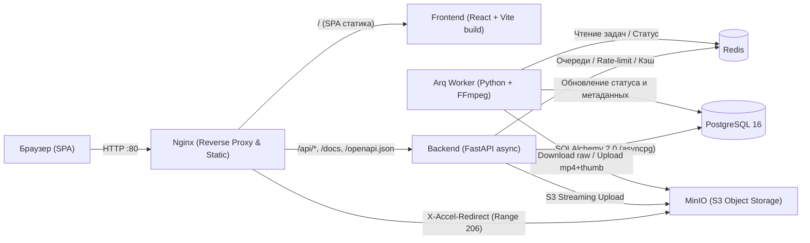
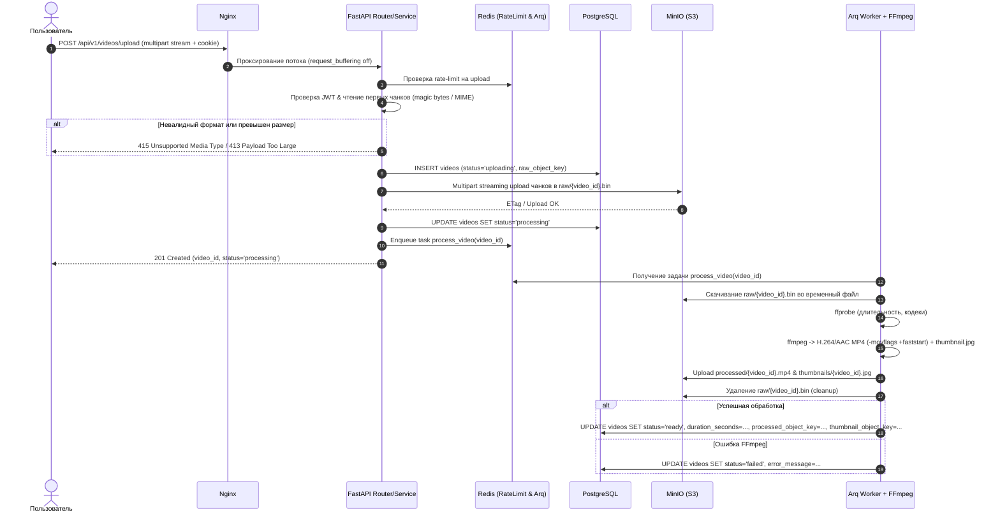
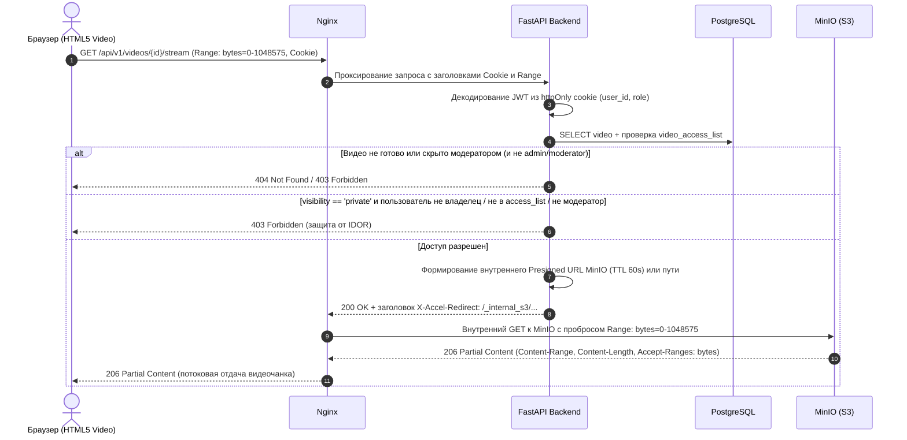

# Архитектура системы (YouTube Clone MVP)

## 1. Обзор и топология сервисов

Система построена по микросервисно-модульной схеме в Docker Compose с единой точкой входа через Nginx. Развертывание на чистой Ubuntu выполняется одной командой (`docker compose up -d --build`).



### Границы ответственности сервисов

| Сервис | Технология | Ответственность |
| :--- | :--- | :--- |
| **nginx** | Nginx Alpine | Единая точка входа (порт 80). Отдает собранную статику SPA, проксирует `/api/*` и `/docs` на `backend`, выполняет стриминг видео/превью из MinIO по внутреннему `X-Accel-Redirect` с поддержкой `Range` (`206 Partial Content`). |
| **backend** | Python 3.12, FastAPI (async) | REST API (`/api/v1`), аутентификация (JWT в `httpOnly` cookies), RBAC, защита от IDOR, rate-limiting, валидация загрузок (magic bytes), потоковая загрузка в MinIO без буферизации в RAM, постановка задач в Redis. |
| **worker** | Arq + FFmpeg / ffprobe | Фоновая обработка видео: извлечение метаданных (длительность, разрешение), генерация превью (thumbnail), транскодирование в H.264/AAC MP4 с `-movflags +faststart`, обновление статуса видео в PostgreSQL. |
| **postgres** | PostgreSQL 16 | Основное хранилище данных: пользователи, видео, права доступа к `private` видео, плейлисты, комментарии, реакции, подписки, жалобы, refresh-токены. |
| **redis** | Redis 7 | Брокер очереди фоновых задач (Arq), счетчики rate-limiting (`/auth/*`, `/videos/upload`), опциональный кэш прав доступа/метаданных. |
| **minio** | MinIO (S3-compatible) | Объектное хранилище. Бакет `videos` (префиксы `raw/`, `processed/`, `thumbnails/`, `avatars/`). Доступен только во внутренней сети Docker (наружу не проброшен). |
| **frontend** | React, TypeScript, Vite, Tailwind CSS | SPA-клиент в стиле YouTube с поддержкой темной/светлой темы. |

---

## 2. Слоистая архитектура Backend

Внутри `backend/app/` соблюдается строгая однонаправленная зависимость слоев:

```text
api/v1/routers  ──▶  services  ──▶  repositories  ──▶  models
```

- **`api/v1/routers/`** — только HTTP-уровень: валидация входных данных (Pydantic v2), `Depends` для извлечения текущего пользователя/роли, маппинг доменных исключений в HTTP-статусы (`400`, `401`, `403`, `404`, `409`, `413`, `415`, `429`), формирование ответов и Swagger-документации. Прямые SQL-запросы, вызовы MinIO или Redis запрещены.
- **`services/`** — вся бизнес-логика: проверка прав доступа (ownership, `private` access list, RBAC), оркестрация репозиториев, вызовы S3-клиента, постановка задач в Arq, бизнес-валидации.
- **`repositories/`** — инкапсуляция всех запросов к PostgreSQL через `AsyncSession` SQLAlchemy 2.0. Без бизнес-логики и HTTP-исключений.
- **`models/`** — декларативные ORM-модели SQLAlchemy 2.0, Enum-типы, внешние ключи и индексы.
- **`core/`** — конфигурация (`pydantic-settings`), безопасность (JWT, Argon2), клиент MinIO, rate-limiter на Redis, доменные исключения.

---

## 3. Критичные потоки данных (Sequence-диаграммы)

### 3.1. Поток загрузки видео, сохранения в S3 и фоновой обработки FFmpeg

Загрузка выполняется потоково (chunked streaming), без вычитывания файла целиком в оперативную память.



### 3.2. Поток просмотра `private` видео с проверкой прав и Range-стримингом



---

## 4. Обоснование выбора механизма защиты приватных видео

Для защиты `private` видео и раздачи медиафайлов выбран паттерн **Nginx `X-Accel-Redirect` (внутреннее перенаправление) поверх приватного бакета MinIO** вместо прямой выдачи Presigned URLs клиенту.

### Сравнение подходов

| Критерий | `X-Accel-Redirect` (выбран) | Прямой Presigned URL клиенту |
| :--- | :--- | :--- |
| **Изоляция хранилища** | MinIO полностью скрыт во внутренней сети Docker; клиент общается только с Nginx (`/api/v1/...`). | Порт MinIO или прокси на бакет должен быть доступен клиенту напрямую. |
| **Мгновенный отзыв прав** | Права (владелец, `video_access_list`, `is_hidden`) проверяются при каждом запросе/чанке на бэкенде. Отзыв доступа действует немедленно. | Выданный URL остается валидным до истечения TTL, даже если владелец уже забрал доступ или видео скрыл модератор. |
| **Поддержка `Range` и нагрузка на Python** | FastAPI выполняет только легкую проверку прав и возвращает пустой ответ с `X-Accel-Redirect`. Передачу байтов и `206 Partial Content` берет на себя Nginx (C/epoll). | Передача идет мимо FastAPI, но ценой потери контроля после выдачи ссылки. |
| **Совместимость с HTML5 `<video>` и CORS** | Один origin, нативная работа с `httpOnly` cookies без передачи токенов в query string и без проблем с CORS. | Требуются настройки CORS на S3 и обновление URL при истечении срока жизни во время длинного просмотра. |

**Дополнение по безопасности:** Внутренний location `/_internal_s3/` в Nginx помечен директивой `internal;`, поэтому клиент не может обратиться к нему напрямую, минуя проверку прав в FastAPI.

---

## 5. Стандарты информационной безопасности (ИБ)

1. **Аутентификация:** `access_token` (короткий TTL, например 15 мин) и `refresh_token` (7–30 дней) передаются исключительно в `httpOnly`, `SameSite=Lax` cookies (`Secure` при HTTPS). Refresh-токены хранятся в БД в виде SHA-256 хеша и ротируются при каждом обновлении.
2. **Пароли:** хеширование с помощью `Argon2id` (`argon2-cffi`).
3. **RBAC:** явные зависимости FastAPI `get_current_user`, `get_optional_user`, `require_roles(Role.MODERATOR, Role.ADMIN)`.
4. **Защита от IDOR:**
   - Изменение/удаление видео, плейлистов, комментариев и управление `video_access_list` разрешены только владельцу (или модератору/админу в рамках полномочий).
   - Доступ к `private` видео проверяется как на метаданных (`GET /videos/{id}`), так и на стриминге (`/stream`) и превью (`/thumbnail`).
5. **Безопасность загрузок:** проверка magic bytes контейнеров (MP4/MOV `ftyp`, WebM/MKV `1A 45 DF A3`, JPEG `FF D8 FF`, PNG `89 50 4E 47`, WebP `RIFF...WEBP`), ограничение максимального размера, хранение в S3 строго по UUID-ключам.
6. **Rate-limiting:** Redis-лимитер на `/api/v1/auth/*` (защита от брутфорса) и `/api/v1/videos/upload` (защита от исчерпания диска/очереди).
