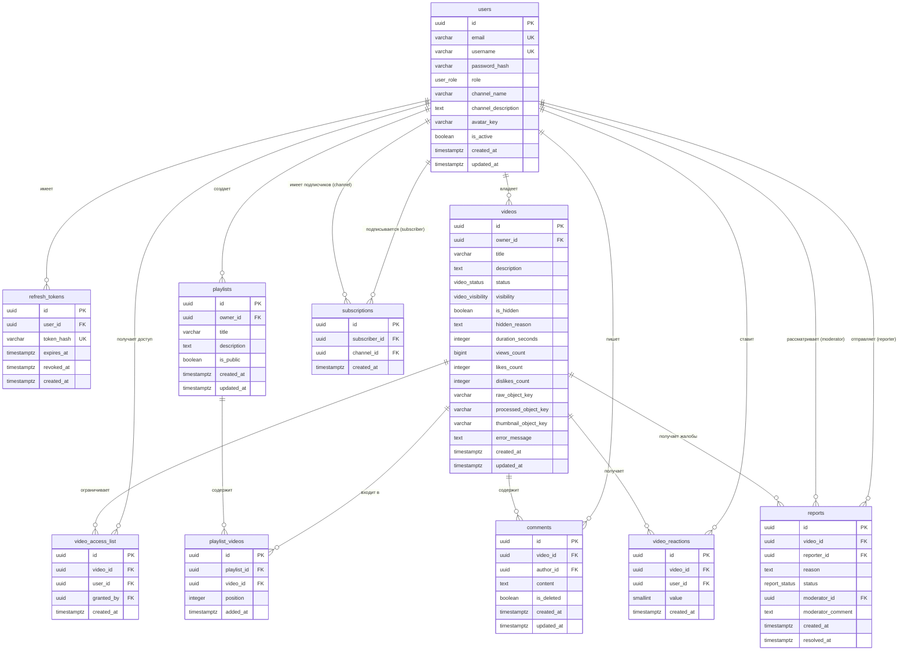

# Проектирование базы данных (PostgreSQL 16)

## 1. ER-диаграмма



---

## 2. Enum-типы и описание таблиц

### PostgreSQL Enum-типы
- `user_role`: `'user'`, `'moderator'`, `'admin'`
- `video_status`: `'uploading'`, `'processing'`, `'ready'`, `'failed'`
- `video_visibility`: `'public'`, `'private'`
- `report_status`: `'pending'`, `'resolved'`, `'dismissed'`

---

### 2.1. `users` — Пользователи и каналы
Хранит учетные записи, роли RBAC и метаданные канала автора.

| Поле | Тип | Ограничения | Описание |
| :--- | :--- | :--- | :--- |
| `id` | `UUID` | `PK, DEFAULT gen_random_uuid()` | Идентификатор пользователя |
| `email` | `VARCHAR(255)` | `NOT NULL, UNIQUE` | Email (в нижнем регистре) |
| `username` | `VARCHAR(64)` | `NOT NULL, UNIQUE` | Уникальный логин / handle канала |
| `password_hash` | `VARCHAR(255)` | `NOT NULL` | Хеш пароля (Argon2id) |
| `role` | `user_role` | `NOT NULL, DEFAULT 'user'` | Роль в системе (`user`, `moderator`, `admin`) |
| `channel_name` | `VARCHAR(100)` | `NOT NULL` | Отображаемое название канала |
| `channel_description` | `TEXT` | `NULL` | Описание канала |
| `avatar_key` | `VARCHAR(255)` | `NULL` | Ключ аватара в MinIO |
| `is_active` | `BOOLEAN` | `NOT NULL, DEFAULT TRUE` | Активность аккаунта |
| `created_at` | `TIMESTAMPTZ` | `NOT NULL, DEFAULT now()` | Дата регистрации |
| `updated_at` | `TIMESTAMPTZ` | `NOT NULL, DEFAULT now()` | Дата обновления |

---

### 2.2. `refresh_tokens` — Сессии и ротация refresh-токенов
Обеспечивает отзыв сессий при logout и защиту от повторного использования скомпрометированных refresh-токенов.

| Поле | Тип | Ограничения | Описание |
| :--- | :--- | :--- | :--- |
| `id` | `UUID` | `PK` | Идентификатор токена |
| `user_id` | `UUID` | `FK -> users(id) ON DELETE CASCADE, NOT NULL` | Владелец токена |
| `token_hash` | `VARCHAR(64)` | `NOT NULL, UNIQUE` | SHA-256 хеш refresh-токена |
| `expires_at` | `TIMESTAMPTZ` | `NOT NULL` | Время истечения |
| `revoked_at` | `TIMESTAMPTZ` | `NULL` | Время отзыва (при logout или ротации) |
| `created_at` | `TIMESTAMPTZ` | `NOT NULL, DEFAULT now()` | Время выдачи |

---

### 2.3. `videos` — Видео и их состояние в S3
Центральная таблица системы. Счетчики `views_count`, `likes_count`, `dislikes_count` денормализованы для быстрой отрисовки ленты без тяжелых `COUNT(*)` при каждом запросе.

| Поле | Тип | Ограничения | Описание |
| :--- | :--- | :--- | :--- |
| `id` | `UUID` | `PK` | Идентификатор видео |
| `owner_id` | `UUID` | `FK -> users(id) ON DELETE CASCADE, NOT NULL` | Автор (владелец канала) |
| `title` | `VARCHAR(200)` | `NOT NULL` | Название видео |
| `description` | `TEXT` | `NULL` | Описание видео |
| `status` | `video_status` | `NOT NULL, DEFAULT 'uploading'` | Статус пайплайна обработки |
| `visibility` | `video_visibility` | `NOT NULL, DEFAULT 'public'` | Режим доступа (`public`, `private`) |
| `is_hidden` | `BOOLEAN` | `NOT NULL, DEFAULT FALSE` | Скрыто ли видео модератором |
| `hidden_reason` | `TEXT` | `NULL` | Причина скрытия модератором |
| `duration_seconds` | `INTEGER` | `NULL, CHECK (duration_seconds >= 0)` | Длительность (заполняет FFmpeg-воркер) |
| `views_count` | `BIGINT` | `NOT NULL, DEFAULT 0` | Счетчик просмотров |
| `likes_count` | `INTEGER` | `NOT NULL, DEFAULT 0` | Счетчик лайков |
| `dislikes_count` | `INTEGER` | `NOT NULL, DEFAULT 0` | Счетчик дизлайков |
| `raw_object_key` | `VARCHAR(255)` | `NULL` | Ключ исходника в MinIO |
| `processed_object_key` | `VARCHAR(255)` | `NULL` | Ключ транскодированного MP4 в MinIO |
| `thumbnail_object_key` | `VARCHAR(255)` | `NULL` | Ключ превью в MinIO |
| `error_message` | `TEXT` | `NULL` | Сообщение об ошибке при `status='failed'` |
| `created_at` | `TIMESTAMPTZ` | `NOT NULL, DEFAULT now()` | Дата создания |
| `updated_at` | `TIMESTAMPTZ` | `NOT NULL, DEFAULT now()` | Дата обновления |

---

### 2.4. `video_access_list` — Доступ к `private` видео
Список пользователей, которым владелец явно выдал право просмотра приватного видео.

| Поле | Тип | Ограничения | Описание |
| :--- | :--- | :--- | :--- |
| `id` | `UUID` | `PK` | Идентификатор записи |
| `video_id` | `UUID` | `FK -> videos(id) ON DELETE CASCADE, NOT NULL` | Приватное видео |
| `user_id` | `UUID` | `FK -> users(id) ON DELETE CASCADE, NOT NULL` | Пользователь с доступом |
| `granted_by` | `UUID` | `FK -> users(id) ON DELETE CASCADE, NOT NULL` | Кто выдал доступ |
| `created_at` | `TIMESTAMPTZ` | `NOT NULL, DEFAULT now()` | Дата выдачи доступа |

- **Уникальное ограничение:** `UNIQUE (video_id, user_id)`.

---

### 2.5. `playlists` и `playlist_videos` — Плейлисты

**`playlists`**
| Поле | Тип | Ограничения | Описание |
| :--- | :--- | :--- | :--- |
| `id` | `UUID` | `PK` | Идентификатор плейлиста |
| `owner_id` | `UUID` | `FK -> users(id) ON DELETE CASCADE, NOT NULL` | Владелец плейлиста |
| `title` | `VARCHAR(150)` | `NOT NULL` | Название плейлиста |
| `description` | `TEXT` | `NULL` | Описание |
| `is_public` | `BOOLEAN` | `NOT NULL, DEFAULT TRUE` | Видимость плейлиста |
| `created_at` | `TIMESTAMPTZ` | `NOT NULL, DEFAULT now()` | Дата создания |
| `updated_at` | `TIMESTAMPTZ` | `NOT NULL, DEFAULT now()` | Дата обновления |

**`playlist_videos`**
| Поле | Тип | Ограничения | Описание |
| :--- | :--- | :--- | :--- |
| `id` | `UUID` | `PK` | Идентификатор связи |
| `playlist_id` | `UUID` | `FK -> playlists(id) ON DELETE CASCADE, NOT NULL` | Плейлист |
| `video_id` | `UUID` | `FK -> videos(id) ON DELETE CASCADE, NOT NULL` | Видео |
| `position` | `INTEGER` | `NOT NULL, CHECK (position >= 0)` | Позиция для сортировки |
| `added_at` | `TIMESTAMPTZ` | `NOT NULL, DEFAULT now()` | Дата добавления |

- **Уникальное ограничение:** `UNIQUE (playlist_id, video_id)`.

---

### 2.6. `comments` — Комментарии под видео

| Поле | Тип | Ограничения | Описание |
| :--- | :--- | :--- | :--- |
| `id` | `UUID` | `PK` | Идентификатор комментария |
| `video_id` | `UUID` | `FK -> videos(id) ON DELETE CASCADE, NOT NULL` | Видео |
| `author_id` | `UUID` | `FK -> users(id) ON DELETE CASCADE, NOT NULL` | Автор комментария |
| `content` | `TEXT` | `NOT NULL` | Текст комментария |
| `is_deleted` | `BOOLEAN` | `NOT NULL, DEFAULT FALSE` | Мягкое удаление (владельцем или модератором) |
| `created_at` | `TIMESTAMPTZ` | `NOT NULL, DEFAULT now()` | Дата создания |
| `updated_at` | `TIMESTAMPTZ` | `NOT NULL, DEFAULT now()` | Дата редактирования |

---

### 2.7. `video_reactions` — Лайки и дизлайки

| Поле | Тип | Ограничения | Описание |
| :--- | :--- | :--- | :--- |
| `id` | `UUID` | `PK` | Идентификатор реакции |
| `video_id` | `UUID` | `FK -> videos(id) ON DELETE CASCADE, NOT NULL` | Видео |
| `user_id` | `UUID` | `FK -> users(id) ON DELETE CASCADE, NOT NULL` | Пользователь |
| `value` | `SMALLINT` | `NOT NULL, CHECK (value IN (1, -1))` | `1` — лайк, `-1` — дизлайк |
| `created_at` | `TIMESTAMPTZ` | `NOT NULL, DEFAULT now()` | Дата реакции |

- **Уникальный индекс:** `UNIQUE (user_id, video_id)` — один пользователь может поставить только одну реакцию на видео (смена или снятие реакции пересчитывает `likes_count`/`dislikes_count` атомарно).

---

### 2.8. `subscriptions` — Подписки на каналы

| Поле | Тип | Ограничения | Описание |
| :--- | :--- | :--- | :--- |
| `id` | `UUID` | `PK` | Идентификатор подписки |
| `subscriber_id` | `UUID` | `FK -> users(id) ON DELETE CASCADE, NOT NULL` | Кто подписался |
| `channel_id` | `UUID` | `FK -> users(id) ON DELETE CASCADE, NOT NULL` | На кого подписались |
| `created_at` | `TIMESTAMPTZ` | `NOT NULL, DEFAULT now()` | Дата подписки |

- **Ограничения:** `UNIQUE (subscriber_id, channel_id)`, `CHECK (subscriber_id <> channel_id)`.

---

### 2.9. `reports` — Жалобы и модерация

| Поле | Тип | Ограничения | Описание |
| :--- | :--- | :--- | :--- |
| `id` | `UUID` | `PK` | Идентификатор жалобы |
| `video_id` | `UUID` | `FK -> videos(id) ON DELETE CASCADE, NOT NULL` | Видео, на которое подана жалоба |
| `reporter_id` | `UUID` | `FK -> users(id) ON DELETE CASCADE, NOT NULL` | Автор жалобы |
| `reason` | `TEXT` | `NOT NULL` | Причина жалобы |
| `status` | `report_status` | `NOT NULL, DEFAULT 'pending'` | Статус (`pending`, `resolved`, `dismissed`) |
| `moderator_id` | `UUID` | `FK -> users(id) ON DELETE SET NULL, NULL` | Модератор, рассмотревший жалобу |
| `moderator_comment` | `TEXT` | `NULL` | Решение / комментарий модератора |
| `created_at` | `TIMESTAMPTZ` | `NOT NULL, DEFAULT now()` | Дата подачи жалобы |
| `resolved_at` | `TIMESTAMPTZ` | `NULL` | Дата закрытия жалобы |

---

## 3. Стратегия индексирования и поиска

### 3.1. Быстрая выборка главной ленты и каналов
1. **Частичный индекс главной ленты** (отсекает черновики, `private` и скрытые модератором видео, сортировка по новизне):
   ```sql
   CREATE INDEX ix_videos_public_feed
       ON videos (created_at DESC)
       WHERE status = 'ready' AND visibility = 'public' AND is_hidden = FALSE;
   ```
2. **Лента популярных видео** (сортировка по просмотрам):
   ```sql
   CREATE INDEX ix_videos_public_popular
       ON videos (views_count DESC, created_at DESC)
       WHERE status = 'ready' AND visibility = 'public' AND is_hidden = FALSE;
   ```
3. **Видео на странице канала**:
   ```sql
   CREATE INDEX ix_videos_owner_created
       ON videos (owner_id, created_at DESC);
   ```

### 3.2. Поиск по названию видео (`pg_trgm` + `GIN`)
Для мгновенного подстрочного и нечеткого поиска (`ILIKE '%запрос%'` и ранжирования по `similarity()`) без отдельного движка (Elasticsearch) используется расширение `pg_trgm`:

```sql
CREATE EXTENSION IF NOT EXISTS pg_trgm;

CREATE INDEX ix_videos_title_trgm
    ON videos USING GIN (title gin_trgm_ops);
```

- При поиске запрос фильтруется условиями `status = 'ready' AND visibility = 'public' AND is_hidden = FALSE` (или с учетом доступных пользователю видео) и `title ILIKE '%query%'`, что эффективно использует `GIN`-индекс `gin_trgm_ops`.

### 3.3. Индексы для остальных горячих запросов
- **`comments`:** `CREATE INDEX ix_comments_video_created ON comments (video_id, created_at DESC) WHERE is_deleted = FALSE;`
- **`playlist_videos`:** `CREATE INDEX ix_playlist_videos_order ON playlist_videos (playlist_id, position ASC);`
- **`subscriptions`:** `CREATE INDEX ix_subscriptions_channel ON subscriptions (channel_id);` (для подсчета подписчиков; `subscriber_id` покрыт уникальным индексом `(subscriber_id, channel_id)`).
- **`video_access_list`:** `CREATE INDEX ix_video_access_user ON video_access_list (user_id, video_id);`
- **`reports`:** `CREATE INDEX ix_reports_pending ON reports (created_at ASC) WHERE status = 'pending';`
- **`refresh_tokens`:** `CREATE INDEX ix_refresh_tokens_user ON refresh_tokens (user_id) WHERE revoked_at IS NULL;`
